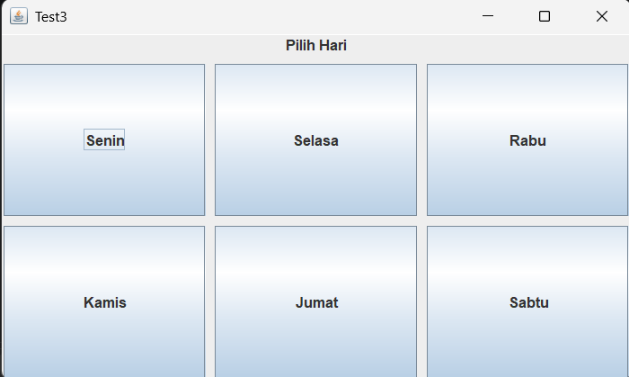
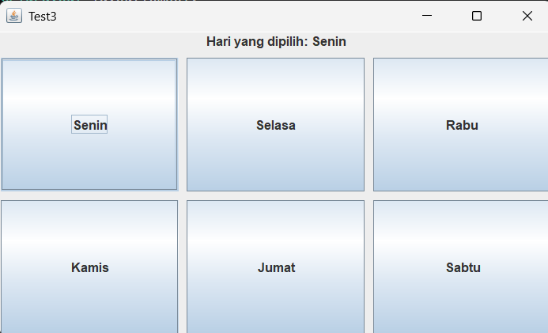

# Tugas Java Swing GUI - Pemilih Hari

Aplikasi Graphical User Interface (GUI) sederhana berbasis Java Swing yang menampilkan antarmuka pemilihan hari (Senin hingga Sabtu) dan merespons interaksi klik pengguna secara dinamis.

## Identitas Mahasiswa
* **Nama:** Imas Nazalia Rahmawati
* **NIM:** F1D02410055

---

## 5 Komponen Utama GUI yang Digunakan

| No. | Kategori Komponen | Class / Interface | Variabel / Implementasi dalam Kode | Fungsi dalam Program |
| :--- | :--- | :--- | :--- | :--- |
| 1 | **Top-level Container Class** | `javax.swing.JFrame` | `public class Test3 extends JFrame` | Jendela utama (frame) aplikasi yang menampung seluruh komponen antarmuka. |
| 2 | **Intermediate Container Class** | `javax.swing.JPanel` | `panelTombol` | Wadah perantara untuk mengelompokkan enam tombol hari agar tata letaknya terpisah dari label utama. |
| 3 | **Atomic Component Class** | `javax.swing.JLabel` & `javax.swing.JButton` | `labelHari`, `tombolSenin` s.d. `tombolSabtu` | Komponen dasar interaksi: `JLabel` menampilkan teks instruksi/hasil pilihan, sedangkan `JButton` berfungsi sebagai tombol pemicu aksi. |
| 4 | **Layout Classes** (2 Class) | `java.awt.BorderLayout` & `java.awt.GridLayout` | `layoutUtama` (`BorderLayout`), `layoutTombol` (`GridLayout`) | `BorderLayout` mengatur posisi `labelHari` di bagian atas (`NORTH`) dan `panelTombol` di tengah (`CENTER`). `GridLayout(2, 3, 8, 8)` menyusun 6 tombol menjadi 2 baris dan 3 kolom dengan jarak 8px. |
| 5 | **Event Listener** | `java.awt.event.ActionListener` (Interface) | `implements ActionListener` & `@Override public void actionPerformed(ActionEvent e)` | Menangani *event* klik pada setiap `JButton` dan memperbarui teks pada `labelHari` sesuai tombol hari yang ditekan. |

---

# Hasil Program
Tampilan Awal : 

Tampilan ketika memilih salah satu hari :
